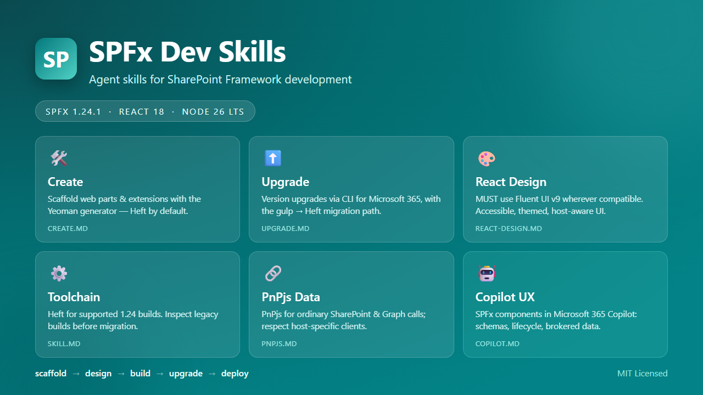

# SPFx Dev Skills

Agent skills for building **SharePoint Framework (SPFx)** solutions: scaffold, design, build, upgrade, and ship from your AI coding agent.



> **Skill preview** - review generated code and commands before committing or deploying. The skill's preview status is separate from the stable **SPFx 1.24.1** release. Remaining release-readiness work is tracked in [todo.md](./todo.md).

## SPFx 1.24.1 baseline

- **SPFx 1.24.1** generator and exact release-coupled runtime/build packages. This maintenance release fixes the 1.24.0 generator's release-candidate package references; updating the generator alone does not upgrade existing projects.
- **React 18.3.1** for `react` and `react-dom`, with compatible React 18 types.
- **Node.js 26 LTS recommended**; supported alternatives are Node 22.14+ within 22.x and Node 24.x, not every version >=22.
- **Heft** for supported 1.24 builds. Existing 1.22/1.23 projects may retain gulp and need migration.
- **Fluent UI v9 is a MUST wherever compatible components are available.** The Copilot React template includes v9; standard React web parts still scaffold v8. Verify dependencies and explain any necessary fallback.

See the shared [environment setup](./plugins/spfx/skills/spfx/references/setup.md), live [compatibility reference](https://learn.microsoft.com/sharepoint/dev/spfx/compatibility), [1.24.1 release notes](https://learn.microsoft.com/sharepoint/dev/spfx/release-1.24.1) and [React 18 migration guide](https://learn.microsoft.com/sharepoint/dev/spfx/react-18-upgrade). Older and SharePoint Server targets need their own supported versions; do not switch them to Node 26 without checking compatibility.

## What's in this repo

One focused **`spfx`** skill loads only the references needed for the task:

```text
plugins/spfx/skills/spfx/
  SKILL.md                  Router, shared rules and toolchain decision
  references/
    setup.md                Target-aware Node and tool prerequisites
    create.md               Scaffold web parts and extensions
    upgrade.md              Version upgrade reports and validation
    react-design.md         Fluent UI v9-first policy and host-aware UI
    pnpjs.md                SharePoint and Microsoft Graph data access
    copilot.md              Copilot UX components and brokered data clients
```

| Capability | Guidance |
| --- | --- |
| **Setup** | [Use SPFx 1.24.1 and Node 26 LTS](./plugins/spfx/skills/spfx/references/setup.md) where supported, respecting existing pins and older/platform targets. |
| **Create** | [Scaffold projects](./plugins/spfx/skills/spfx/references/create.md) with explicit, non-interactive generator flags. |
| **Upgrade** | [Inspect the project and apply an upgrade report](./plugins/spfx/skills/spfx/references/upgrade.md); verify the installed CLI supports the requested target. |
| **React design** | [Use Fluent UI v9 wherever compatible](./plugins/spfx/skills/spfx/references/react-design.md), with host theming, accessibility and responsive layouts. |
| **Toolchain** | [Inspect the configured build](./plugins/spfx/skills/spfx/SKILL.md#toolchain-decision-rule), not just generator metadata. |
| **Data** | [Prefer PnPjs for ordinary SharePoint/Graph work](./plugins/spfx/skills/spfx/references/pnpjs.md), with host-specific exceptions. |
| **Copilot UX** | [Build SPFx UI for Microsoft 365 Copilot](./plugins/spfx/skills/spfx/references/copilot.md): schemas, lifecycle, rendered-view context, brokered clients, testing and deployment. |

The original [evaluation article](https://devblogs.microsoft.com/microsoft365dev/behind-spfx-dev-skills-testing-what-agents-know-and-fixing-what-they-miss/) describes the historical **1.21.1-to-1.22.2** upgrade baseline. It is not validation of 1.24.1 or React 18.

## Install and use

**Manual installation is the supported path for this repository.** No one-command installer or marketplace package is advertised until its distribution is verified.

1. Clone the repository:

   ```console
   git clone https://github.com/SharePoint/spfx-dev-skills.git
   ```

2. Copy the complete **plugins/spfx/skills/spfx** folder, including its references, to **one** supported skill location:

   | Agent | Workspace destination | Personal destination |
   | --- | --- | --- |
   | Copilot in VS Code / Copilot CLI | `.github/skills/spfx/` | `~/.copilot/skills/spfx/` |
   | Claude Code | `.claude/skills/spfx/` | `~/.claude/skills/spfx/` |

   Confirm current locations in the [VS Code](https://code.visualstudio.com/docs/agent-customization/agent-skills), [Copilot CLI](https://docs.github.com/en/copilot/how-tos/copilot-cli/customize-copilot/create-skills) or [Claude Code](https://code.claude.com/docs/en/skills) documentation. Other compatible hosts may use different directories.

3. Start a new agent session. Check that `spfx` appears in its skills list (or `/spfx` where supported), then ask for a task. If discovery fails, check skill support/settings, the destination and that it contains `spfx/SKILL.md`, not an extra nested copy.

Examples:

- "Create an SPFx 1.24.1 React web part called ProjectOverview using Node 26 LTS."
- "Upgrade this solution to SPFx 1.24.1."
- "Build an accessible Fluent UI v9 card layout for this web part."
- "Read items from my Projects list; ask for the schema if it is missing."
- "Create a Copilot UX component that displays my profile."

To update a manual install, pull the repository, replace the installed **spfx** folder including references, and start a new session. Keep local modifications separately and remove duplicate workspace/personal copies. To uninstall, remove only that installed folder.

The skill does not replace the required Node/toolchain or tenant access. A clean build does not prove host integration; review reported validation and blocked checks. Published guidance is also available on [Microsoft Learn](https://learn.microsoft.com/sharepoint/dev/spfx/agent-skills); coordinated article updates are prepared separately.

## Roadmap and feedback

Remaining technical updates are tracked in [todo.md](./todo.md). Verified Skills CLI and plugin/marketplace distribution remain future work.

[Report an issue](https://github.com/SharePoint/spfx-dev-skills/issues) with your prompt, project versions, expected/actual result and validation output. Contributions follow **fork -> branch -> PR to `main`**; see [CONTRIBUTING.md](./CONTRIBUTING.md). Do not include credentials or tenant-sensitive data.

## License

[MIT](./LICENSE). You may use, modify and distribute the content, including commercially, with the required copyright and license notice.
